<div align="center">


# SIPKL BBSPGL

**Web-based Internship Management Information System for Balai Besar Survei dan Pemetaan Geologi Kelautan (BBSPGL).**


</div>

---

<div align="center">

## Overview

**SIPKL (Sistem Informasi Praktik Kerja Lapangan)** is a Laravel-based web application designed to support the administration of internship and fieldwork programs at **BBSPGL**. It connects prospective participants with internship opportunities and provides administrators with tools for processing applications, managing supervisors, monitoring attendance and leave requests, and generating reports.

The application separates **public access**, **participant workflows**, and **administrative workflows** through authentication and role-based authorization.

</div>

## Table of contents

- [Features](#features)
- [Application screenshots](#application-screenshots)
- [Tech stack](#tech-stack)
- [How it works](#how-it-works)
- [Project structure](#project-structure)
- [Getting started](#getting-started)
- [Application roles](#application-roles)
- [Attendance scheduling](#attendance-scheduling)
- [Testing and current limitations](#testing-and-current-limitations)
- [Privacy and security](#privacy-and-security)
- [Developer](#developer)
- [License](#license)

## Features

| Area | Capabilities |
| --- | --- |
| Public internship vacancies | Browse available PKL positions and view vacancy details. |
| Registration and authentication | Participant registration, login, logout, and role-based access to the application. |
| Vacancy management | Administrators can create, review, update, and close internship opportunities. |
| Application management | Participants submit applications; administrators review, accept, or reject them and manage program status. |
| Field supervisors | Manage internship supervisors and associate them with accepted participants. |
| Active participants and alumni | Monitor ongoing internship placements and access alumni records. |
| Attendance | Participant check-in, daily attendance management, history, and attendance summaries. |
| Leave requests | Submit requests for leave or illness and manage approval or rejection. |
| Reports | Attendance recap with PDF export and acceptance report with PDF download. |
| Access management | Management pages for user accounts and roles. |

> **Implementation note:** Features are described from the current application code and available screenshots. A successfully registered route or rendered page is not, by itself, a complete end-to-end test of the feature.

## Application screenshots

The screenshots below were captured from the SIPKL application. Participant names, email addresses, profile photos, and supervisor contact details in selected images have been **redacted for privacy**.

<div align="center">

### Public internship vacancies

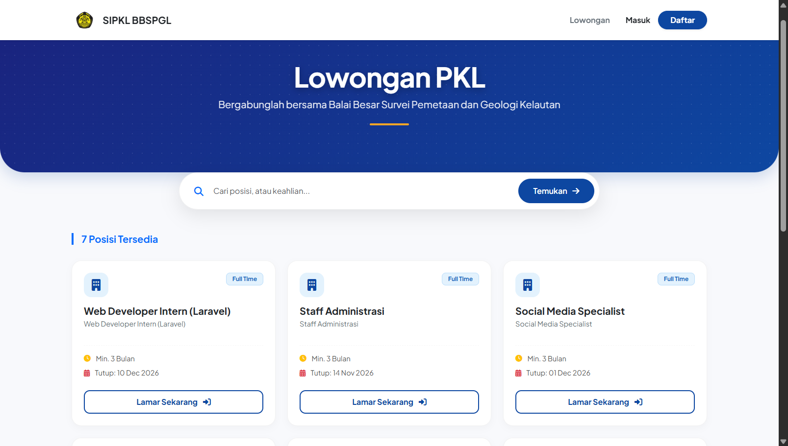

*Public page displaying available internship positions and the vacancy search interface.*

</div>

### Administration

<table>
  <tr>
    <th width="50%">Vacancy management</th>
    <th width="50%">Field supervisor management</th>
  </tr>
  <tr>
    <td>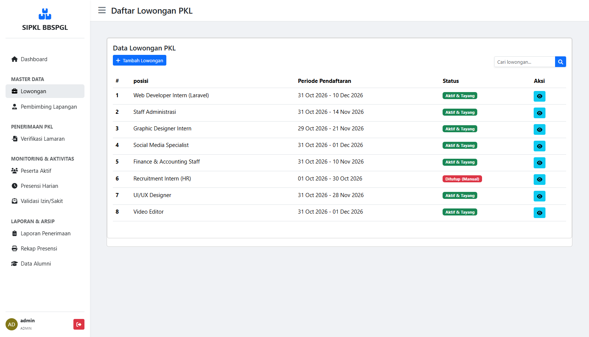</td>
    <td>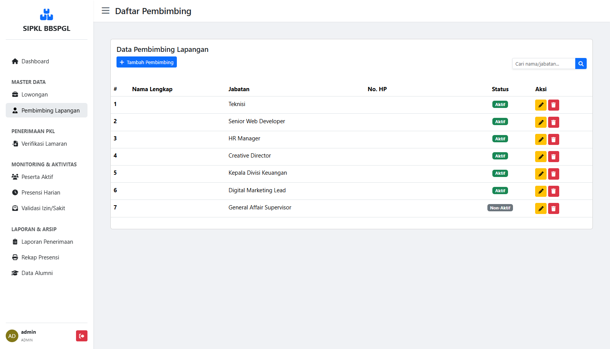</td>
  </tr>
  <tr>
    <th>Application verification</th>
    <th>Active participants</th>
  </tr>
  <tr>
    <td>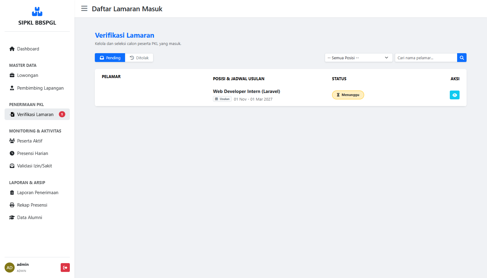</td>
    <td>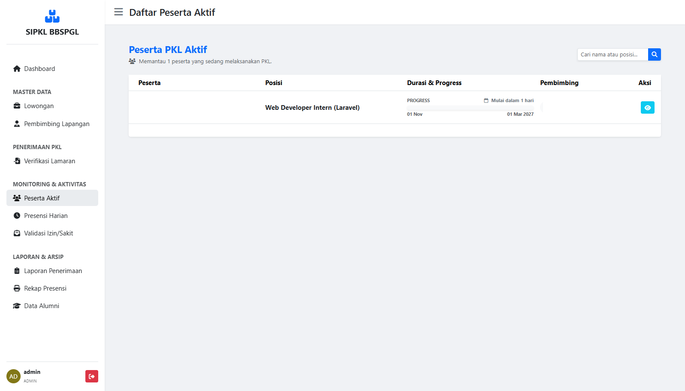</td>
  </tr>
  <tr>
    <th>Daily attendance monitoring</th>
    <th>Leave request validation</th>
  </tr>
  <tr>
    <td>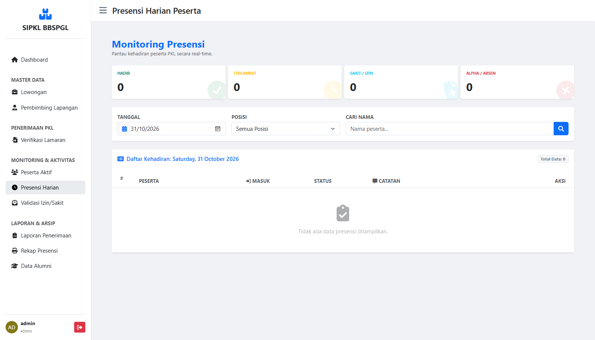</td>
    <td>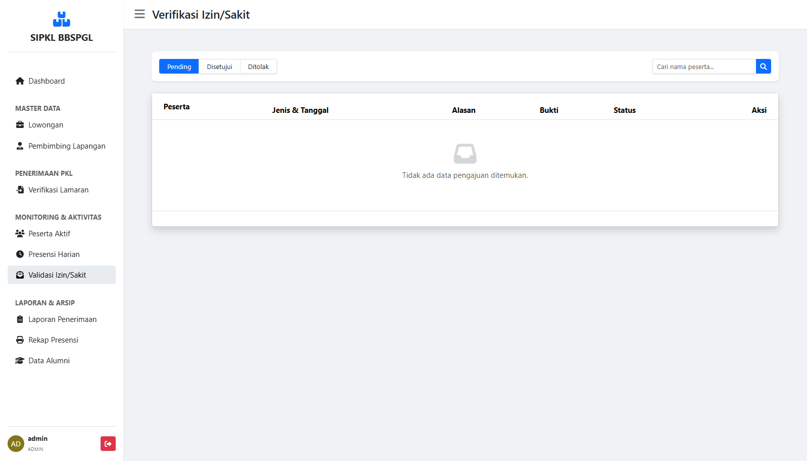</td>
  </tr>
  <tr>
    <th>Acceptance report</th>
    <th>Attendance recap</th>
  </tr>
  <tr>
    <td>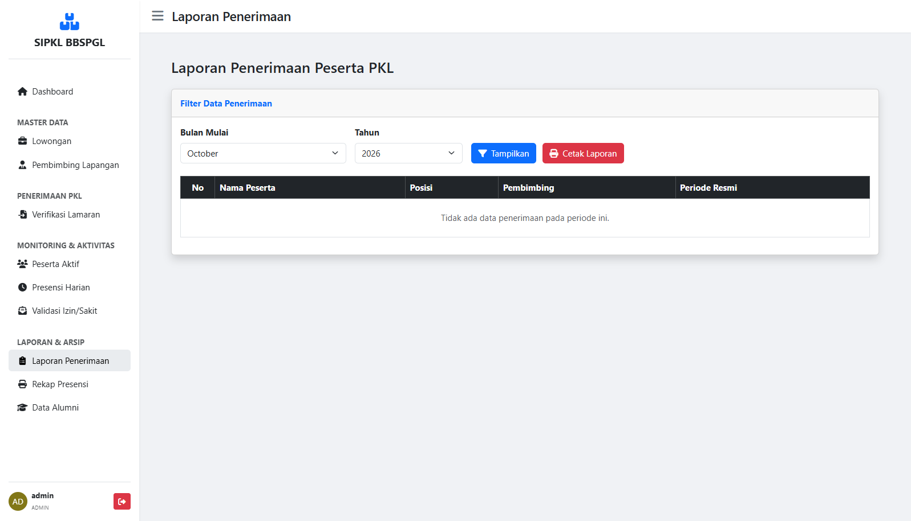</td>
    <td>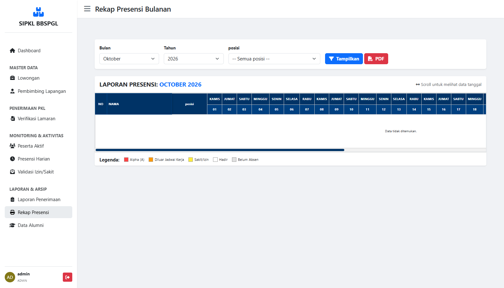</td>
  </tr>
</table>

<div align="center">

### Alumni records

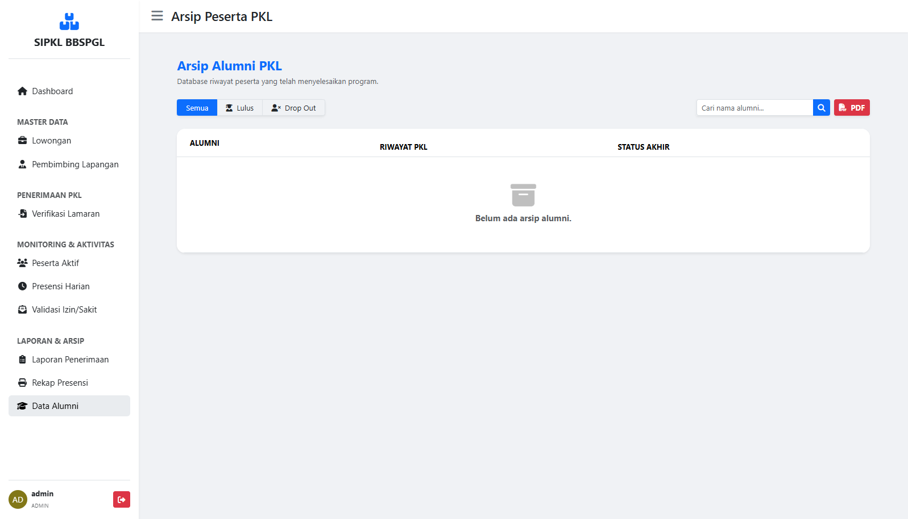

</div>

### Participant interface

<table>
  <tr>
    <th width="50%">Browse vacancies</th>
    <th width="50%">Daily attendance</th>
  </tr>
  <tr>
    <td>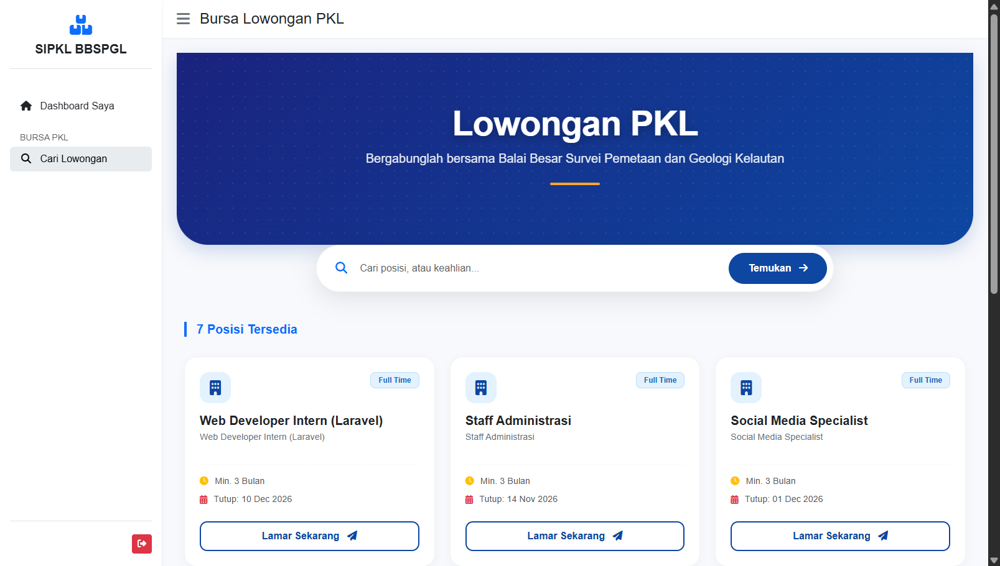</td>
    <td>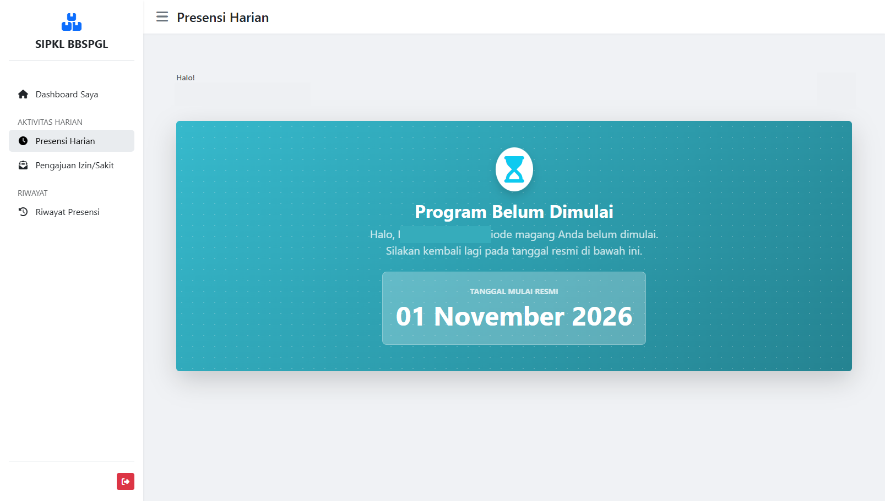</td>
  </tr>
</table>

<div align="center">

### Leave request history

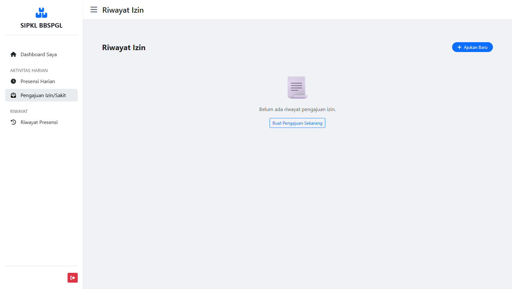

</div>

## Tech stack

| Layer | Technologies | Purpose |
| --- | --- | --- |
| Backend | PHP 8.1+, Laravel 10 | Application logic, routing, authentication, and validation. |
| Database | MySQL | Users, vacancies, applications, attendance, leave requests, and related records. |
| UI | Laravel Blade, HTML, CSS, JavaScript | Server-rendered interfaces and client-side interactions. |
| Asset tooling | Vite 5 | Build and serve frontend assets. |
| PDF | `barryvdh/laravel-dompdf` | Export reports to PDF. |
| API/auth packages | Laravel Sanctum, Guzzle HTTP | Installed backend dependencies. |

## How it works

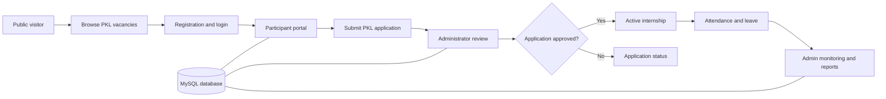

The Laravel backend uses Controllers, Form Requests, Models, and Services to manage application workflows. MySQL stores transactional records, while application files (including participant uploads) are handled through Laravel's file storage facilities. Report generation uses DomPDF.

## Project structure

```text
sipkl-bbspgl/
├── app/
│   ├── Console/Commands/       # Scheduled attendance command
│   ├── Http/
│   │   ├── Controllers/        # Admin, participant, guest, and auth controllers
│   │   ├── Middleware/         # Authentication / role restrictions
│   │   └── Requests/           # Request validation
│   ├── Models/                 # Eloquent models
│   └── Services/               # Application business logic
├── bootstrap/
├── config/
├── database/
│   ├── migrations/             # Database schema
│   └── seeders/                # Role and optional sample-data seeders
├── docs/screenshots/           # Application screenshots for this README
├── public/                     # Public assets, CSS, JavaScript, images
├── resources/views/            # Blade templates
├── routes/                     # Web and API routes
├── storage/                    # Runtime files; private uploads must stay private
├── tests/
├── .env.example
├── composer.json
├── package.json
└── README.md
```

## Getting started

### Prerequisites

- PHP **8.1 or newer** (with the extensions required by Laravel and the PHP dependencies)
- Composer
- MySQL
- Node.js and npm compatible with Vite 5
- Git

> The steps below are intended for a **new development installation** with a new, empty database. Do not run destructive migration commands against an existing institutional or research database.

### 1. Clone the repository

```bash
git clone https://github.com/fedopradipa/sipkl-bbspgl.git
cd sipkl-bbspgl
```

### 2. Install PHP dependencies

```bash
composer install
```

### 3. Configure the environment

For Git Bash or macOS/Linux:

```bash
cp .env.example .env
php artisan key:generate
```

For Windows Command Prompt, use `copy .env.example .env` instead of `cp`.

Create a **new, empty MySQL database** (for example via HeidiSQL or phpMyAdmin):

```sql
CREATE DATABASE db_sipkl_bbspgl
  CHARACTER SET utf8mb4
  COLLATE utf8mb4_unicode_ci;
```

If that database name already exists, **do not recreate or reset it**. Use a different empty database name, and back up existing data before making changes.

Set the following values in `.env` to match your local environment:

```dotenv
APP_NAME="SIPKL BBSPGL"
APP_ENV=local
APP_DEBUG=true
APP_URL=http://127.0.0.1:8000

DB_CONNECTION=mysql
DB_HOST=127.0.0.1
DB_PORT=3306
DB_DATABASE=db_sipkl_bbspgl
DB_USERNAME=root
DB_PASSWORD=
```

The credentials above are an example of a local Laragon installation, not production credentials. Never commit your actual `.env` file.

### 4. Create the database schema

```bash
php artisan migrate
```

The migration set includes tables for roles, users, vacancies, supervisors, applications, attendance, participant profiles, leave requests, and supporting Laravel functionality.

### 5. Seed the application roles

```bash
php artisan db:seed --class=RoleSeeder
```

The current role seeder creates **`admin`** and **`peserta`** roles. The source also references a `superadmin` role, but it is **not created by this seeder**.

**Do not run `php artisan db:seed` indiscriminately on a shared database.** The default seeder also executes `UserSeeder`, `LowonganSeeder`, and `PembimbingSeeder`; review these files before using them because they may insert demonstration accounts or personal-looking sample data.

### 6. Create a local administrator account

For a new, empty development database, open Tinker:

```bash
php artisan tinker
```

Run the following commands **inside Tinker**:

```php
$password = \Illuminate\Support\Str::random(20);
$adminRole = \App\Models\Role::where('nama_role', 'admin')->firstOrFail();
\App\Models\User::create([
    'name' => 'Local Admin',
    'email' => 'admin.local@example.test',
    'password' => \Illuminate\Support\Facades\Hash::make($password),
    'role_id' => $adminRole->id_role,
]);
$password; // Save privately for your local login
exit
```

This example is only for a clean development database. Do not publish the generated password or use the sample account for production.

### 7. Install and run frontend assets

```bash
npm install
npm run dev
```

Keep this terminal running during development.

### 8. Start Laravel

In another terminal from the repository root:

```bash
php artisan serve
```

Open [http://127.0.0.1:8000](http://127.0.0.1:8000). Participant-uploaded files that are intentionally stored on the public disk may require:

```bash
php artisan storage:link
```

The storage link must never be used to expose private participant documents. Confirm disk visibility and access controls before deploying.

### 9. Build assets for deployment

```bash
npm run build
```

Production deployment additionally requires secure HTTPS configuration, disabled debug output, protected storage, correct filesystem permissions, and a configured web server. The development server is not a production deployment method.

## Application roles

| Role | Main access |
| --- | --- |
| Public visitor | Browse vacancies and access login/registration. |
| Participant (`peserta`) | Apply for internships, manage profile, access attendance and leave workflows. |
| Administrator (`admin`) | Manage vacancies, supervisors, applications, participants, reports, and users. |

A `superadmin` role is referenced in parts of the source code, but the current `RoleSeeder` only provides `admin` and `peserta`.

## Attendance scheduling

The application defines the Artisan command `presensi:auto-alpha`, scheduled **every minute** in `app/Console/Kernel.php`. It is intended to register absent participants after the configured attendance cutoff, subject to their approved leave and working-day conditions.

To run the Laravel scheduler in a local development session, use a **separate terminal**:

```bash
php artisan schedule:work
```

**Caution:** Attendance scheduling writes data. Test it only against a dedicated development database and with carefully controlled sample dates. Do not enable it on an institutional dataset without confirming the business rules.

## Testing and current limitations

The following checks were completed during the repository preparation process:

- `php artisan route:list --except-vendor` completed and displayed **76 routes**.
- **12 migrations** completed successfully in a clean MySQL audit database.
- `RoleSeeder` completed successfully; both `admin` and `peserta` roles were retrieved using Laravel Tinker.
- PHP source syntax was checked in the earlier source comparison.

**These checks do not constitute full end-to-end testing.** The code review also identified matters that should be verified or addressed before public or production use:

- Differences between the current attendance service and migration schema (notably an `is_auto_closed` field reference).
- Case consistency between controller namespaces and directories for Linux deployments.
- References to legacy admin profile routes/views.
- The absence of previously implemented participant check-out and final-report upload routes in this version.
- The `superadmin` role/seed configuration mismatch.

## Privacy and security

- Do not commit `.env`, production credentials, SQL dumps, private documents, or real participant records.
- Review seeders for demonstration credentials and sample identities before sharing the repository publicly.
- Keep the historical Git commits under review as well; `.gitignore` only affects newly tracked content, not secrets in earlier commits.
- Public screenshot examples in this documentation have selected identifying fields redacted.
- Treat this project as a development/portfolio implementation until the remaining functional and security checks are completed.

## Developer

**Fedo Orvala Pradipa** — SIPKL application development as part of an IT fieldwork/internship project at BBSPGL Cirebon.

GitHub: [@fedopradipa](https://github.com/fedopradipa)

## License

No standalone `LICENSE` file was present in the reviewed SIPKL2 source archive. The `MIT` entry in `composer.json` is package metadata; it does not, by itself, establish a clear license grant for this repository. Confirm repository licensing before adding a public license badge.
